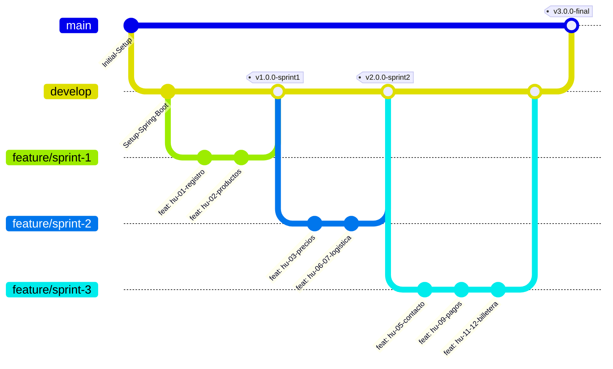

# AgroValle Connect — Plataforma Agrícola del Valle del Cauca

[](.github/workflows/ci.yml)
[-brightgreen?style=for-the-badge&logo=codecov&logoColor=white)](target/site/jacoco/index.html)
[-orange?style=for-the-badge&logo=openjdk&logoColor=white)](https://adoptium.net/)
[](https://spring.io/)
[](https://www.postgresql.org/)
[](src/main/resources/db/migration)
[](docs/dod.md)

---

## Información Institucional y del Proyecto

- **Institución:** Institución Universitaria Antonio José Camacho (UNIAJC)
- **Facultad:** Facultad de Ingeniería
- **Programa Académico:** Ingeniería de Sistemas
- **Asignatura:** Ingeniería de Software II | **Período:** 2-2026
- **Docente Titular:** Paola Andrea Bedoya Toro
- **Proyecto Integrador:** AgroValle Connect (Comercialización y Trazabilidad Agrícola del Valle del Cauca)
- **Equipo Scrum:** Grupo 5

---

## 1. Declaración de la Visión del Producto

> **Para** los pequeños y medianos productores agrícolas del Valle del Cauca (Dagua, Palmira, Buga, etc.),  
> **Que** necesitan comercializar cosechas de forma directa y sin intermediarios abusivos que distorsionen los precios,  
> **AgroValle Connect** es una plataforma web empresarial basada en Java 17, Spring Boot y arquitectura en 4 capas,  
> **Que** conecta la oferta agrícola de las fincas con la demanda comercial urbana de Cali a precios justos y transparentes,  
> **A diferencia de** las cadenas de intermediación tradicionales y las ventas informales desarticuladas,  
> **Nuestro producto** garantiza trazabilidad transaccional, pagos seguros con pasarela virtual, acreditación inmediata en billetera del agricultor, algoritmos de cálculo de fletes y contratos de API auditables bajo estándares internacionales (**ISO/IEC 25010** e **ISO/IEC/IEEE 29148:2018**).

---

## 2. Célula Scrum y Roles de Ingeniería

| Nombre Completo | Cédula de Ciudadanía | Rol Scrum | Usuario GitHub |
|---|---|---|---|
| **Dilan Stiven Castillo Valencia** | CC 1089002055 | Scrum Master | [@DilanStiven](https://github.com/DilanStiven) |
| **Kevin Estiven Lucumi Polo** | CC 1030534697 | Developer | [@Steven-L777](https://github.com/Steven-L777) |
| **Carlos Andres Rosales Lara** | CC 1030020342 | Developer | [@adnoireph](https://github.com/adnoireph) |
| **Santiago Edilmo Hurtado Cuenu** | CC 1089001065 | Developer | [@santiageao](https://github.com/santiageao) |

---

## 3. Stack Tecnológico y Arquitectura de Software

El sistema está construido bajo una **Arquitectura en 4 Capas** desacoplada mediante inyección de dependencias por constructor:

1. **Capa de Presentación (REST API):** Controladores en `@RestController` con validación estricta de payloads mediante DTOs y anotaciones de Bean Validation (`@Valid`).
2. **Capa de Seguridad y Middleware:** Spring Security Stateless con autenticación JWT (HMAC-SHA256), filtro interceptor `JwtAuthenticationFilter` y passwords cifrados con `BCryptPasswordEncoder`.
3. **Capa de Lógica de Negocio (Domain Services):** Servicios de dominio anotados con `@Service` y control de transaccionalidad atómica `@Transactional`.
4. **Capa de Acceso a Datos (Spring Data JPA):** Interfaces de persistencia `JpaRepository` desacopladas del motor relacional PostgreSQL, con control de concurrencia pesimista en órdenes críticas.

### Patrones de Diseño GoF Implementados
- **Data Transfer Object (DTO):** Aislamiento total entre los modelos JPA de base de datos y los contratos HTTP de la API REST.
- **Repository:** Abstracción y encapsulamiento del acceso a la base de datos relacional.
- **Strategy (Patrón del Comportamiento):** Implementado en `CalculadorTarifaService` y `TarifaStrategy` para calcular fletes según distancia y peso sin acoplar el servicio principal.
- **Observer (Patrón del Comportamiento):** Implementado mediante `ApplicationEventPublisher` y `@EventListener` (`SolicitudContactoCreadaListener`) para emitir y registrar notificaciones asíncronas sin bloquear la transacción principal.

---

## 4. Estructura Organizativa del Repositorio (ISO/IEC 25010)

Estructura de archivos y artefactos estandarizada para garantizar mantenibilidad, auditabilidad y trazabilidad:

```
agrovalle-connect/
├── .github/
│   ├── ISSUE_TEMPLATE/
│   │   ├── feature_request.md          # Plantilla BDD/GWT para nuevas funcionalidades
│   │   └── bug_report.md               # Plantilla formal para reporte de defectos
│   └── workflows/
│       ├── ci.yml                      # Pipeline de CI (Compilación, Checkstyle, JUnit 5, JaCoCo)
│       └── cd.yml                      # Pipeline de CD (Inyección de Secrets y Despliegue PaaS)
├── docs/
│   ├── architecture/
│   │   └── diagramas-uml.md            # 7 Diagramas UML consolidados en sintaxis Mermaid.js
│   ├── architecture-decisions/
│   │   ├── ADR-001-despliegue-staging-paas.md         # Registro de decisión PaaS Staging
│   │   └── ADR-002-estrategia-despliegue-produccion.md  # Registro de decisión Producción
│   ├── metrics/
│   │   └── sprint-metrics-corte3.md    # Velocity, Burndown diario, CFD y Lead/Cycle Time
│   ├── requirements/
│   │   ├── ieee-29148-syrs-agrovalle.md # Especificación formal SyRS ISO/IEC/IEEE 29148:2018
│   │   └── product-backlog-bdd.md      # 15 Historias de Usuario con escenarios Given-When-Then
│   ├── sprints/
│   │   ├── sprint-0/                   # Readiness, DoD técnico, estrategia Git y setup
│   │   ├── sprint-1/                   # Cimientos del Marketplace (HU-01, HU-02, HU-04)
│   │   ├── sprint-2/                   # Mercado y Logística Base (HU-03, HU-06, HU-07)
│   │   └── sprint-3/                   # Pedidos, Pagos y Staging (HU-05, HU-09..HU-12)
│   ├── clean-code-review.md            # Certificación de revisión de código por pares y SOLID
│   └── dod.md                          # Contrato de calidad Definition of Done
├── src/
│   ├── main/
│   │   ├── java/com/agrovalle/agrovalle_connect/
│   │   │   ├── controllers/            # Controladores REST (@RestController + DTOs)
│   │   │   ├── dtos/                   # Objetos de Transferencia de Datos
│   │   │   ├── events/                 # Eventos y Listeners (Patrón Observer)
│   │   │   ├── exceptions/             # Manejador global de errores (@ControllerAdvice)
│   │   │   ├── models/                 # Entidades JPA (@Entity en 3FN)
│   │   │   ├── repositories/           # Repositorios Spring Data JPA
│   │   │   ├── security/               # Seguridad Stateless JWT y BCrypt
│   │   │   ├── services/               # Lógica de Negocio y Transacciones
│   │   │   └── strategies/             # Estrategias de Flete (Patrón Strategy)
│   │   └── resources/
│   │       ├── application.properties  # Perfil por defecto (Desarrollo local)
│   │       ├── application-staging.yml # Perfil desacoplado con variables de entorno
│   │       └── db/migration/           # 17 Migraciones SQL Flyway (V1..V17)
│   └── test/
│       ├── java/                       # 35 Clases de Pruebas Unitarias e Integración
│       └── resources/
│           └── application-test.yml    # Configuración de pruebas H2 en memoria
├── checkstyle.xml                      # Reglas de estilo Google Java Style
├── package.json                         # Instalación de Husky para los hooks Git
├── pom.xml                             # Configuración Maven (Java 17, Spring Boot, JaCoCo)
└── README.md                           # Portada y documentación central del proyecto
```

---

## 5. Estrategia de Ramificación: GitFlow

El equipo adoptó la estrategia **GitFlow** para aislar el trabajo en curso, garantizar la estabilidad de las versiones entregables y mantener una línea de integración continua verificada por pruebas automáticas:



### Reglas de Gobernanza en Git
1. **Protección de Ramas:** Nadie programa directamente sobre `main` ni `develop`. Prohibido el uso de `push --force`.
2. **Convención de Ramas:** Cada incremento se desarrolla en una rama `feature/HU-XX-descripcion`.
3. **Pull Requests con Peer Review:** Ningún PR se integra sin la aprobación de al menos un revisor y con el pipeline de GitHub Actions en verde.
4. **Conventional Commits:** Todos los commits siguen el formato semántico normativo:
   - `feat:` Nuevas características funcionales.
   - `fix:` Corrección de defectos o errores.
   - `docs:` Actualizaciones de documentación.
   - `test:` Creación o refactorización de pruebas automatizadas.
   - `chore:` Tareas de configuración, dependencias o mantenimiento.

---

## 6. Documentación de Arquitectura, Métricas y Requerimientos

Los artefactos técnicos requeridos para la evaluación del Tercer Corte se encuentran enlazados a continuación:

- **Contrato de Calidad (DoD):** [`docs/dod.md`](docs/dod.md) (Checklist completo bajo norma ISO/IEC 25010).
- **Diagramas UML Consolidados:** [`docs/architecture/diagramas-uml.md`](docs/architecture/diagramas-uml.md) (Secuencia HU-07, HU-02, HU-03; Colaboración HU-12, HU-13; Componentes MVC 4 capas; Despliegue PaaS).
- **Reporte de Métricas Ágiles de Flujo:** [`docs/metrics/sprint-metrics-corte3.md`](docs/metrics/sprint-metrics-corte3.md) (Velocity S1 a S3, Burndown diario Sprint 3, CFD con WIP limits, Lead Time 4.2d, Cycle Time 1.8d).
- **Especificación de Requerimientos (SyRS):** [`docs/requirements/ieee-29148-syrs-agrovalle.md`](docs/requirements/ieee-29148-syrs-agrovalle.md) (Norma ISO/IEC/IEEE 29148:2018).
- **Product Backlog BDD (15 Historias de Usuario):** [`docs/requirements/product-backlog-bdd.md`](docs/requirements/product-backlog-bdd.md).
- **Ciclo Metodológico por Sprints:** [`docs/sprints/`](docs/sprints/) (`sprint-0/`, `sprint-1/`, `sprint-2/`, `sprint-3/` con Planning, Review y Retrospectiva).
- **Lista de Chequeo Clean Code Review y SOLID:** [`docs/clean-code-review.md`](docs/clean-code-review.md).
- **Registros de Decisiones de Arquitectura (ADR):** [`docs/architecture-decisions/`](docs/architecture-decisions/) (`ADR-001` Staging PaaS y `ADR-002` Producción).

---

## 7. Catálogo de Endpoints REST Principales

| Módulo | Método | Endpoint | Acceso / Rol | Descripción Funcional |
|---|:---:|---|:---:|---|
| **Salud** | `GET` | `/api/v1/estado` | Público | Verificación de salud y telemetría de Staging (HTTP 200 OK). |
| **Auth** | `POST` | `/api/v1/auth/register` | Público | Registro de agricultor y emisión de credencial. |
| **Auth** | `POST` | `/api/v1/auth/login` | Público | Autenticación con BCrypt y emisión de token JWT. |
| **Productos** | `POST` | `/api/v1/productos` | Bearer `AGRICULTOR` | Publicación de cosecha y validación de fecha. |
| **Productos** | `GET` | `/api/v1/productos` | Público | Catálogo con filtros por categoría y municipio. |
| **Precios** | `GET` | `/api/v1/precios/promedio` | Público | Consulta de precio promedio ponderado regional (24h). |
| **Contacto** | `POST` | `/api/v1/contacto/mensaje` | Autenticado | Intención de compra, pedido pendiente y notificación Observer. |
| **Pagos** | `POST` | `/api/v1/pagos` | Autenticado | Procesamiento de pasarela virtual, inventario y orden. |
| **Billetera** | `GET` | `/api/v1/billetera` | Bearer `AGRICULTOR` | Consulta de saldo acreditado y transacciones. |
| **Notificaciones** | `GET` | `/api/v1/notificaciones` | Bearer `AGRICULTOR` | Listado de alertas y solicitudes de compradores. |
| **Logística** | `POST` | `/api/v1/ordenes` | Bearer `AGRICULTOR` | Creación de orden logística y cálculo de tarifa Strategy. |
| **Logística** | `PATCH` | `/api/v1/ordenes/{id}/alistado` | Bearer `AGRICULTOR` | Transición de orden a lista para despacho. |

---

## 8. Guía de Ejecución Local y Pruebas

### Prerrequisitos
- **Java Development Kit (JDK):** Versión 17 LTS (Eclipse Temurin recomendado).
- **Base de Datos:** PostgreSQL 14+ (o ejecución automática sobre H2 en memoria para pruebas).
- **Maven Wrapper:** Incluido en la raíz del repositorio (`mvnw` / `mvnw.cmd`).

### 1. Clonación del Repositorio
```bash
git clone https://github.com/DilanStiven/Ingenieria-de-software.git
cd Ingenieria-de-software
```

Para instalar Husky y activar el hook local de pre-commit, ejecuta `npm install` en la raíz del repositorio (requiere Node.js/npm y Git).

### 2. Compilación Limpia y Verificación Estática (Checkstyle)
- **Linux / macOS:**
  ```bash
  ./mvnw clean compile
  ./mvnw checkstyle:check
  ```
- **Windows PowerShell:**
  ```powershell
  .\mvnw.cmd clean compile
  .\mvnw.cmd checkstyle:check
  ```

### 3. Ejecución de Pruebas Unitarias y Cobertura JaCoCo
Ejecuta las 35 clases de pruebas automáticas y verifica el cumplimiento del umbral de cobertura JaCoCo (>= 60%):
- **Linux / macOS:**
  ```bash
  ./mvnw verify
  ```
- **Windows PowerShell:**
  ```powershell
  .\mvnw.cmd verify
  ```

*El reporte detallado de cobertura en formato HTML se genera en `target/site/jacoco/index.html`.*

### 4. Ejecución del Servidor Backend
```bash
./mvnw spring-boot:run
# En Windows PowerShell:
.\mvnw.cmd spring-boot:run
```
La API iniciará localmente en el puerto `8080`. Para verificar la disponibilidad del servicio:
```bash
curl -X GET http://localhost:8080/api/v1/estado
```
