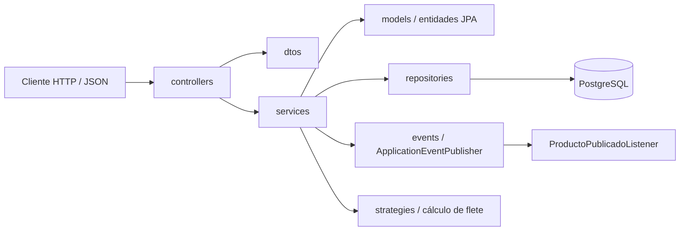
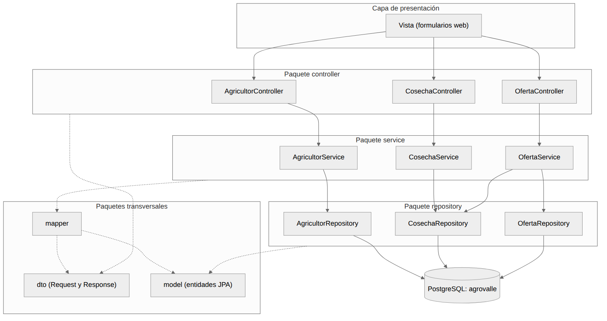
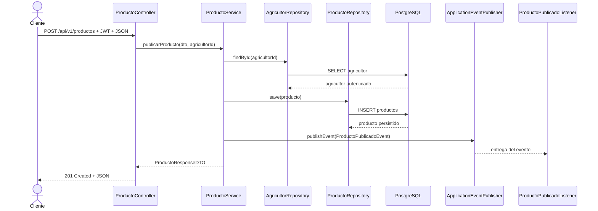
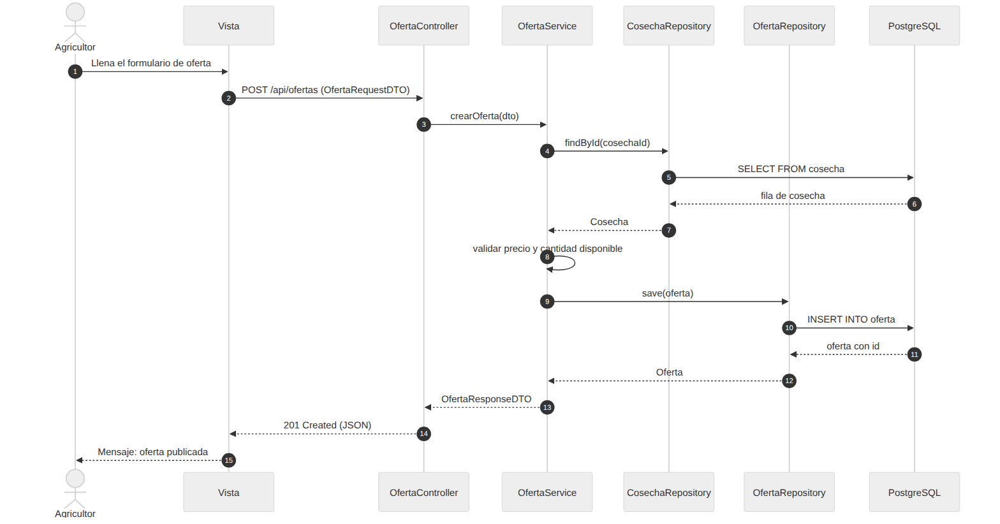
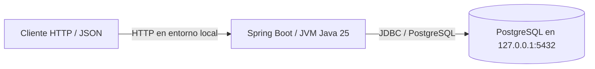
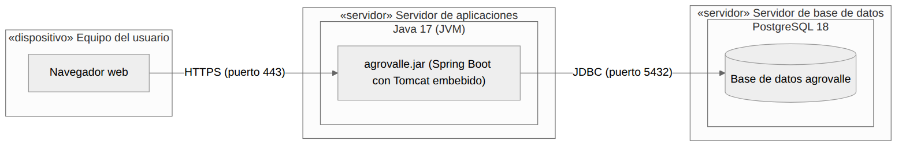

# Documento de arquitectura de software

Arquitectura MVC en capas con Spring Boot

Ingeniería de Software II \| Proyecto AgroValle \| Grupo 5

## 1. Objetivo

Este documento describe la arquitectura de software del proyecto: el estilo arquitectónico elegido (MVC en capas), la organización de paquetes, los diagramas de componentes, secuencia y despliegue, y los patrones de diseño aplicados. La tecnología base es Java 25, Spring Boot 4.1.1, Spring Data JPA y PostgreSQL.

> **Estado de los diagramas:** las imágenes de componentes, secuencia y despliegue son artefactos
> del diseño académico inicial. Las vistas Mermaid de esta sección documentan la arquitectura
> actual: Java 25 y API REST, sin una interfaz web implementada en este repositorio.

## 2. Estilo arquitectónico: MVC en capas

El sistema se organiza en capas donde cada una tiene una única responsabilidad y solo se comunica con la capa contigua. Esto reduce el acoplamiento, facilita las pruebas y permite modificar una capa sin afectar a las demás.

| **Capa** | **Paquete actual** | **Responsabilidad** | **Anotación / mecanismo** |
|---|---|---|---|
| Presentación / API REST | `controllers` | Recibe peticiones HTTP, valida DTOs y devuelve códigos y cuerpos HTTP; no contiene reglas de negocio. | `@RestController` |
| Lógica de negocio | `services` | Aplica reglas del dominio y coordina persistencia y eventos. | `@Service` |
| Acceso a datos | `repositories` | Abstrae consultas y persistencia mediante Spring Data JPA. | `JpaRepository` |
| Persistencia / dominio | `models` | Entidades JPA mapeadas a tablas relacionales. | `@Entity` |
| Transferencia | `dtos` | Define datos de entrada y salida de la API; evita exponer entidades en los contratos de escritura. | Bean Validation / Jackson |

### Estructura de paquetes

```text
com.agrovalle.agrovalle_connect
├── controllers (AgricultorController, ProductoController, ...)
├── services    (AgricultorService, ProductoService, CalculadorTarifaService, ...)
├── repositories (AgricultorRepository, ProductoRepository, ...)
├── models      (Agricultor, Producto, Categoria, ...)
├── dtos        (AgricultorRequestDTO, ProductoRequestDTO, ...)
├── strategies  (CalculoFleteStrategy y estrategias por municipio)
└── events      (ProductoPublicadoEvent y su listener)
```

## 3. Diagrama de componentes

El diagrama muestra los paquetes del sistema y sus dependencias. Las flechas continuas indican llamadas entre capas (API REST → Controller → Service → Repository → Base de datos); las punteadas indican el uso de los paquetes de apoyo (`dtos` y `models`).

La imagen siguiente conserva el diseño académico inicial. El grafo actual de dependencias es:





*Figura 1. Diagrama de componentes del diseño académico inicial*

Reglas que se respetan:

- El controlador nunca accede directamente a la base de datos ni a los repositorios.

- El repositorio no contiene reglas de negocio; solo consulta y guarda datos.

- Los contratos de escritura de la API usan DTOs; las entidades JPA permanecen en la capa de dominio/persistencia.

> El código fuente no tiene una capa de vistas web separada ni un paquete `mapper`; la API REST es
> la capa de presentación y el mapeo DTO-entidad se realiza actualmente en los servicios.

## 4. Diagrama de secuencia: publicar producto

El diagrama incluido fue elaborado para el diseño inicial del caso de uso de oferta. El siguiente flujo Mermaid describe la publicación actual de un producto mediante `POST /api/v1/productos`:





*Figura 2. Diagrama de secuencia del diseño académico inicial*

| **Paso** | **Descripción** |
|---|---|
| 1 | El cliente envía `POST /api/v1/productos` con un `ProductoRequestDTO` y autenticación JWT. |
| 2 | `ProductoController` valida el DTO y obtiene el ID del agricultor autenticado. |
| 3 | `ProductoService` valida la fecha y consulta el propietario mediante `AgricultorRepository`. |
| 4 | El servicio crea la entidad `Producto` y la persiste mediante `ProductoRepository`. |
| 5 | Tras guardar, `ProductoService` publica `ProductoPublicadoEvent`; `ProductoPublicadoListener` recibe el evento. |
| 6 | El controlador devuelve `ProductoResponseDTO` con HTTP 201 Created. |

## 5. Diagrama de despliegue

La imagen siguiente es una propuesta académica de topología. El despliegue local observado usa
Java 25, Spring Boot con servidor embebido y PostgreSQL; no hay una interfaz web independiente.
Los puertos y URL de desarrollo dependen del entorno.





*Figura 3. Diagrama de despliegue del diseño académico inicial*

| **Nodo**                  | **Software / artefacto**                                       | **Comunicación**                                     |
|---------------------------|----------------------------------------------------------------|------------------------------------------------------|
| Equipo del usuario        | Navegador web                                                  | HTTPS (puerto 443) hacia el servidor de aplicaciones |
| Servidor de aplicaciones  | Java 25 (JVM), agrovalle.jar con Spring Boot y Tomcat embebido | JDBC (puerto 5432) hacia la base de datos            |
| Servidor de base de datos | PostgreSQL; la versión no está fijada en la configuración de la aplicación | Recibe conexiones JDBC del servidor de aplicaciones |

## 6. Patrones de diseño aplicados

Los ejemplos de `Oferta` y `Cosecha` en las secciones siguientes describen el diseño inicial.
La implementación vigente utiliza `Agricultor` y `Producto`; la sección 6.5 muestra su
correspondencia con el código real.

### 6.1 Repository

**Problema:** el código de negocio no debería depender de cómo se consultan o guardan los datos.

**Solución:** una interfaz que encapsula el acceso a datos. Con Spring Data JPA solo se declara la interfaz y el framework genera la implementación.

**Dónde se aplica:** paquete `repositories` (`AgricultorRepository`, `ProductoRepository` y otros repositorios del dominio).

```java
public interface OfertaRepository extends JpaRepository<Oferta, Long> {

    List<Oferta> findByEstado(String estado);

}
```

### 6.2 DTO (Data Transfer Object)

**Problema:** exponer las entidades JPA directamente al cliente revela la estructura interna de la base de datos y acopla la API a ella.

**Solución:** objetos simples, solo con los datos necesarios, que viajan entre el cliente y el controlador (RequestDTO para entrada, ResponseDTO para salida).

**Dónde se aplica:** paquete `dtos` (por ejemplo, `AgricultorRequestDTO`, `ProductoRequestDTO` y sus DTOs de respuesta).

```java
public record OfertaRequestDTO(Long cosechaId,
                               BigDecimal precioKg,
                               BigDecimal cantidadDisponible) {}
```

### 6.3 Data Mapper

**Problema:** convertir entre entidades y DTO dentro del servicio ensucia la lógica de negocio con código repetitivo.

**Solución:** cuando la conversión crece, una clase dedicada puede mapear DTOs y entidades, escrita a mano o generada con MapStruct.

**Estado actual:** no existe un paquete `mapper`; `ProductoService` realiza el mapeo necesario entre `ProductoRequestDTO` y `Producto`. El ejemplo siguiente corresponde al diseño inicial.

```java
@Component
public class OfertaMapper {

    public Oferta toEntity(OfertaRequestDTO dto, Cosecha cosecha) {
        Oferta o = new Oferta();
        o.setCosecha(cosecha);
        o.setPrecioKg(dto.precioKg());
        o.setCantidadDisponible(dto.cantidadDisponible());
        return o;
    }

}
```

### 6.4 Singleton e inversión de control (IoC)

**Problema:** crear los objetos con new genera acoplamiento fuerte y dificulta las pruebas.

**Solución:** el contenedor de Spring crea una única instancia (singleton) de cada componente (@Service, @Repository, @RestController, @Component) y la inyecta por constructor donde se necesita. La clase declara sus dependencias y no las crea.

**Dónde se aplica:** en todas las capas; el ejemplo muestra el servicio y el controlador.

```java
@Service
public class OfertaService {

    private final OfertaRepository ofertaRepository;
    private final CosechaRepository cosechaRepository;
    private final OfertaMapper mapper;

    public OfertaService(OfertaRepository ofertaRepository,
                         CosechaRepository cosechaRepository,
                         OfertaMapper mapper) {
        this.ofertaRepository = ofertaRepository;
        this.cosechaRepository = cosechaRepository;
        this.mapper = mapper;
    }

}

@RestController
@RequestMapping("/api/ofertas")
public class OfertaController {

    private final OfertaService ofertaService;

    public OfertaController(OfertaService ofertaService) {
        this.ofertaService = ofertaService;
    }

    @PostMapping
    public ResponseEntity<OfertaResponseDTO> crear(
            @RequestBody OfertaRequestDTO dto) {
        return ResponseEntity.status(HttpStatus.CREATED)
                .body(ofertaService.crearOferta(dto));
    }

}
```

### 6.5 Implementación actual en el repositorio

| Principio / patrón | Evidencia en el código actual |
|---|---|
| SRP | `ProductoController` recibe HTTP y delega; `ProductoService` aplica reglas de publicación/consulta; `ProductoRepository` accede a datos. |
| OCP / LSP | `CalculoFleteStrategy` define el contrato común y `FleteDaguaStrategy`, `FletePalmiraStrategy` y `FleteBugaStrategy` son intercambiables en `CalculadorTarifaService`. |
| ISP | `CalculoFleteStrategy` expone solo los dos métodos necesarios para resolver y calcular el flete; cada repositorio se limita a su entidad. |
| DIP | `ProductoService` recibe sus repositorios y `ApplicationEventPublisher` por constructor; `CalculadorTarifaService` recibe una lista de estrategias por abstracción. |
| Repository / DTO | `ProductoRepository` abstrae persistencia; `ProductoRequestDTO` y `ProductoResponseDTO` definen el contrato HTTP. |
| Observer | `ProductoService` publica `ProductoPublicadoEvent`; `ProductoPublicadoListener` lo recibe mediante `@EventListener`. |

`CalculadorTarifaServiceTest` comprueba el despacho a las tres estrategias, la normalización del
municipio y el rechazo de municipios desconocidos. Esta prueba verifica que las implementaciones
respeten el contrato intercambiable sin acoplar el servicio a una clase concreta.

## 7. Conclusiones

- La arquitectura MVC en capas separa responsabilidades y deja cada capa con una única razón para cambiar.

- Los diagramas de componentes, secuencia y despliegue documentan la estructura estática, el comportamiento y la distribución física del sistema.

- Los patrones Repository, DTO e IoC reducen el acoplamiento y hacen el código más fácil de probar y mantener. El mapeo DTO-entidad se mantiene dentro de los servicios mientras siga siendo sencillo.

- El modelo de datos definido en el punto anterior se integra con esta arquitectura a través de las entidades JPA del paquete model.

## 8. Requisitos de Software (IEEE 29148)

### Requisitos Funcionales
Los siguientes requisitos son candidatos de diseño; no todos corresponden a endpoints o funciones
implementadas en esta copia del repositorio.

| ID | Requisito | Descripción | Estado / criterio |
|---|---|---|---|
| RF-01 | Publicar producto agrícola | El agricultor autenticado puede publicar un producto agrícola. | Implementado en `POST /api/v1/productos`; retorna HTTP 201 con un `ProductoResponseDTO`. |
| RF-02 | Registrar oferta sobre una cosecha | El agricultor publica una cosecha ya registrada como oferta de venta. | Diseño inicial; no hay entidades `Cosecha`/`Oferta` ni endpoint `/api/ofertas` en el código actual. |
| RF-03 | Inicio de sesión con contraseña | El agricultor autentica una cuenta existente con correo y contraseña. | Mockup de diseño; no hay endpoint de login ni credenciales de correo/contraseña en el modelo actual. |

### Requisitos No Funcionales
- **RNF-01 (Seguridad):** Autenticación basada en JWT para endpoints protegidos.
- **RNF-02 (Rendimiento):** objetivo propuesto de respuesta inferior a 200 ms; no se encontró evidencia de una prueba de rendimiento que lo certifique.

---

## 9. Estrategia de Pruebas: TDD y BDD

### BDD (escenario de diseño; no es evidencia de una prueba ejecutada)
**Escenario:** Publicación exitosa de una oferta de cultivo
- **Dado que** el agricultor autenticado tiene una cosecha disponible
- **Cuando** envía los datos de la oferta con un precio y cantidad válidos
- **Entonces** el sistema guarda la oferta en PostgreSQL y responde HTTP 201 Created.

### TDD (Ciclo JUnit 5 + Mockito)
1. **Red:** Se escribe una prueba que falle para el escenario BDD que se va a implementar; las pruebas actuales incluyen `ProductoServiceTest` y `CalculadorTarifaServiceTest`.
2. **Green:** Se implementa el cambio mínimo en el servicio correspondiente para pasar la prueba.
3. **Refactor:** Se limpia el código manteniendo las pruebas en verde y Checkstyle sin errores.
