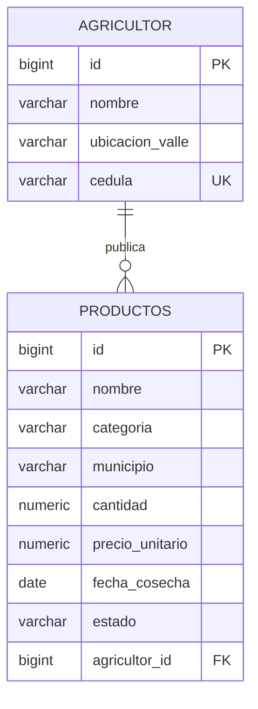

# Documento de normalización y persistencia implementada

Diseño académico propuesto y contraste con el modelo JPA vigente

> **Alcance:** este documento y su modelo de cinco entidades describen el diseño académico
> inicial, no la persistencia implementada actualmente. El código vigente modela `Agricultor` y
> `Producto`; la entidad `Producto` guarda directamente municipio, categoría, cantidad, precio,
> fecha y estado. No debe usarse este documento como descripción del esquema desplegado.

Ingeniería de Software II \| Proyecto AgroValle \| Grupo 5

## 1. Persistencia implementada actualmente

La aplicación vigente tiene dos entidades JPA y dos tablas relacionales. La tabla `productos`
guarda los datos de publicación, incluidos municipio y categoría, y referencia al agricultor
propietario. La categoría no es una entidad JPA independiente. El DDL reproducible para una
base vacía está en [`schema.sql`](schema.sql); no es un mecanismo de migración y no debe
ejecutarse sin revisión sobre una base existente.

La base PostgreSQL local consultada el 28/10/2026 confirmó ambas tablas, la restricción única
`uk_agricultor_cedula`, la FK de `productos.agricultor_id` y el índice
`idx_productos_filtro`. La base tenía un agricultor y cero productos al finalizar la validación.
El modelo relacional académico de cinco entidades que sigue se conserva como propuesta de diseño,
no como un inventario del esquema desplegado.

## 2. Objetivo

Esta sección describe el proceso de normalización del modelo académico propuesto, partiendo de
una estructura sin normalizar y llegando a un diseño en Tercera Forma Normal (3FN). No afirma que
las cinco entidades estén implementadas o desplegadas.

## 3. Entidades identificadas

En el diseño propuesto se identificaron cinco entidades principales:

- **Municipio:** lugar de origen de los agricultores.

- **Agricultor:** persona que registra cosechas y las ofrece en la plataforma.

- **Producto:** tipo de producto agrícola (por ejemplo, tomate o cebolla) y su categoría.

- **Cosecha:** cantidad de un producto cosechada por un agricultor en una fecha.

- **Oferta:** publicación de una cosecha para su venta, con precio y cantidad disponible.

## 4. Punto de partida: datos sin normalizar

Si toda la información se guardara en una sola tabla, los datos de cada agricultor quedarían agrupados con sus productos en una misma celda:

| **agricultor** | **correo**    | **municipio** | **productos cosechados**                                                      |
|----------------|---------------|---------------|-------------------------------------------------------------------------------|
| Juan Pérez     | juan@mail.com | Palmira       | Tomate, Hortaliza, 200 kg, 2026-05-10; Cebolla, Hortaliza, 150 kg, 2026-05-12 |
| Ana Gómez      | ana@mail.com  | Palmira       | Tomate, Hortaliza, 300 kg, 2026-05-11                                         |

Este diseño presenta los siguientes problemas:

- **Valores no atómicos:** una celda contiene varios productos con varios datos mezclados, lo que impide consultar o filtrar por producto.

- **Redundancia:** el correo, el municipio y la categoría "Hortaliza" se repiten en múltiples filas.

- **Anomalía de actualización:** si Juan cambia de municipio, hay que modificar todas sus filas.

- **Anomalía de inserción:** no se puede registrar un producto nuevo sin que exista una cosecha, ni un municipio sin agricultores.

- **Anomalía de borrado:** al eliminar la única cosecha de un producto se pierde también la información del producto.

## 5. Primera Forma Normal (1FN)

**Regla:** todos los atributos deben contener valores atómicos (indivisibles), no puede haber grupos repetidos y cada fila debe identificarse con una llave primaria.

Se separa cada producto cosechado en su propia fila, de modo que cada celda contenga un único dato. La llave primaria compuesta es (correo, producto, fecha_cosecha):

| **correo (PK)** | **producto (PK)** | **fecha_cosecha (PK)** | **nombre** | **municipio** | **categoria** | **cantidad_kg** |
|-----------------|-------------------|------------------------|------------|---------------|---------------|-----------------|
| juan@mail.com   | Tomate            | 2026-05-10             | Juan Pérez | Palmira       | Hortaliza     | 200             |
| juan@mail.com   | Cebolla           | 2026-05-12             | Juan Pérez | Palmira       | Hortaliza     | 150             |
| ana@mail.com    | Tomate            | 2026-05-11             | Ana Gómez  | Palmira       | Hortaliza     | 300             |

**Resultado:** la tabla cumple la 1FN. Aún persiste redundancia, que se resuelve en la siguiente forma normal.

## 6. Segunda Forma Normal (2FN)

**Regla:** debe cumplir la 1FN y todo atributo que no es parte de la llave debe depender de toda la llave primaria, no solo de una parte de ella (sin dependencias parciales).

Al analizar las dependencias funcionales de la tabla anterior se encuentran dependencias parciales:

| **Dependencia funcional**                       | **Tipo**                                        |
|-------------------------------------------------|-------------------------------------------------|
| correo → nombre, municipio                      | Parcial (depende solo de una parte de la llave) |
| producto → categoria                            | Parcial (depende solo de una parte de la llave) |
| (correo, producto, fecha_cosecha) → cantidad_kg | Total (depende de toda la llave)                |

Para eliminarlas se dividen los datos en tres tablas, cada una con los atributos que dependen de su propia llave: AGRICULTOR (correo, nombre, municipio), PRODUCTO (producto, categoria) y COSECHA (correo, producto, fecha_cosecha, cantidad_kg).

**Resultado:** los datos del agricultor y del producto se guardan una sola vez, y desaparecen las anomalías de actualización asociadas a ellos.

## 7. Tercera Forma Normal (3FN)

**Regla:** debe cumplir la 2FN y ningún atributo que no es llave puede depender de otro atributo que tampoco es llave (sin dependencias transitivas). En resumen, cada atributo depende "de la llave, de toda la llave y nada más que de la llave".

Se aplicaron las siguientes decisiones de diseño:

- **Municipio como entidad propia:** el municipio se guardaba como texto dentro del agricultor, con riesgo de inconsistencias ("Palmira", "palmira", "Palmira "). Al convertirlo en la tabla MUNICIPIO, el agricultor solo guarda una referencia (municipio_id). Además, si se agregan atributos del municipio (por ejemplo, departamento), no se genera una dependencia transitiva agricultor → municipio → departamento.

- **Oferta separada de la cosecha:** el precio, la cantidad disponible y el estado dependen de la oferta y no de la cosecha, porque una misma cosecha puede publicarse varias veces con precios distintos. Por eso se ubican en la tabla OFERTA.

- **Llaves sustitutas:** se reemplazan las llaves compuestas y naturales (correo, nombre de producto) por una llave numérica autoincremental (id SERIAL) en cada tabla. Esto simplifica las llaves foráneas y evita que un cambio de correo o de nombre se propague por todo el modelo. El correo se mantiene como valor único (UNIQUE).

### Dependencias funcionales del modelo final

| **Tabla**  | **Dependencias funcionales**                                               |
|------------|----------------------------------------------------------------------------|
| municipio  | id → nombre                                                                |
| agricultor | id → nombre, correo, cedula, municipio_id, fecha_registro                    |
| producto   | id → nombre, categoria                                                     |
| cosecha    | id → agricultor_id, producto_id, cantidad_kg, fecha_cosecha                |
| oferta     | id → cosecha_id, precio_kg, cantidad_disponible, estado, fecha_publicacion |

En todas las tablas los únicos determinantes son la llave primaria, por lo que no existen dependencias parciales ni transitivas y el modelo cumple la 3FN.

Observación: el campo categoria se mantiene como texto en la tabla PRODUCTO porque depende directamente del producto. Si en el futuro la categoría necesitara atributos propios, podría convertirse en una tabla independiente.

## 8. Modelo relacional propuesto

| **Tabla**  | **Llave primaria** | **Atributos**                                             | **Llaves foráneas**                                        |
|------------|--------------------|-----------------------------------------------------------|------------------------------------------------------------|
| municipio  | id                 | nombre                                                    | —                                                          |
| agricultor | id | nombre, correo (único), cedula (única), fecha_registro     | municipio_id → municipio(id)                               |
| producto   | id                 | nombre, categoria                                         | —                                                          |
| cosecha    | id                 | cantidad_kg, fecha_cosecha                                | agricultor_id → agricultor(id); producto_id → producto(id) |
| oferta     | id                 | precio_kg, cantidad_disponible, estado, fecha_publicacion | cosecha_id → cosecha(id)                                   |

### Relaciones y cardinalidad

| **Entidad origen** | **Entidad destino** | **Cardinalidad** | **Descripción**                        |
|--------------------|---------------------|------------------|----------------------------------------|
| Municipio          | Agricultor          | 1 : N            | Un municipio tiene muchos agricultores |
| Agricultor         | Cosecha             | 1 : N            | Un agricultor registra muchas cosechas |
| Producto           | Cosecha             | 1 : N            | Un producto aparece en muchas cosechas |
| Cosecha            | Oferta              | 1 : N            | Una cosecha puede tener varias ofertas |

## 9. Conclusiones del diseño propuesto

- El modelo final cumple la 3FN: cada dato se almacena en un único lugar y cada tabla describe una sola entidad.

- Se eliminaron las anomalías de inserción, actualización y borrado identificadas en el diseño inicial.

- Las relaciones entre tablas se garantizan mediante llaves foráneas, lo que asegura la integridad referencial en PostgreSQL.

- El diseño facilita el mapeo a entidades JPA y futuras ampliaciones del sistema.

## Anexo: DDL del modelo académico propuesto

El script se conserva en [`schema-academico-propuesto.sql`](schema-academico-propuesto.sql).
No es una migración de Flyway ni debe ejecutarse sobre la base de datos de la aplicación actual.
