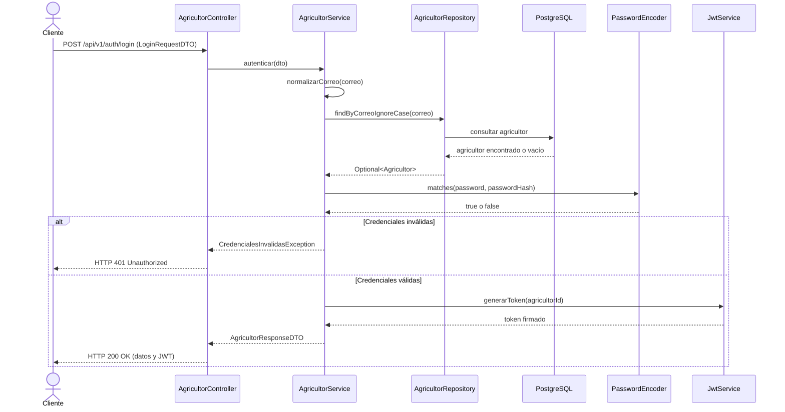
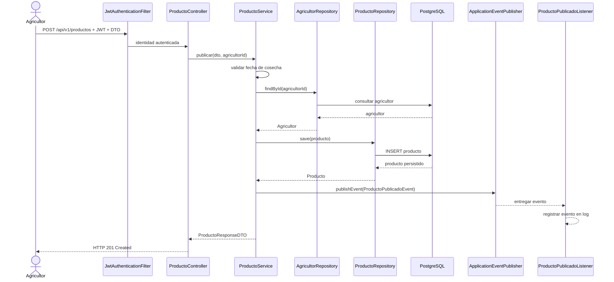
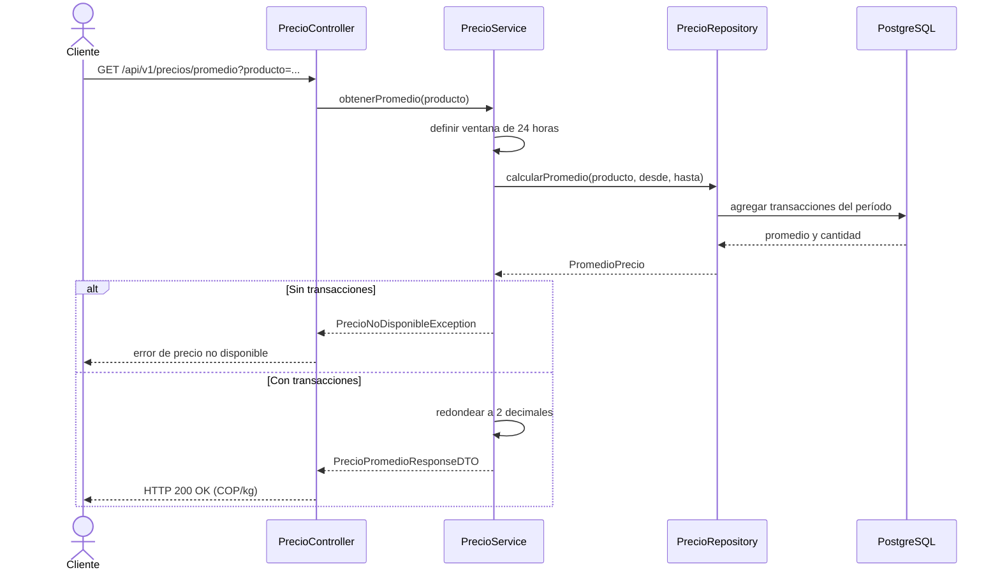
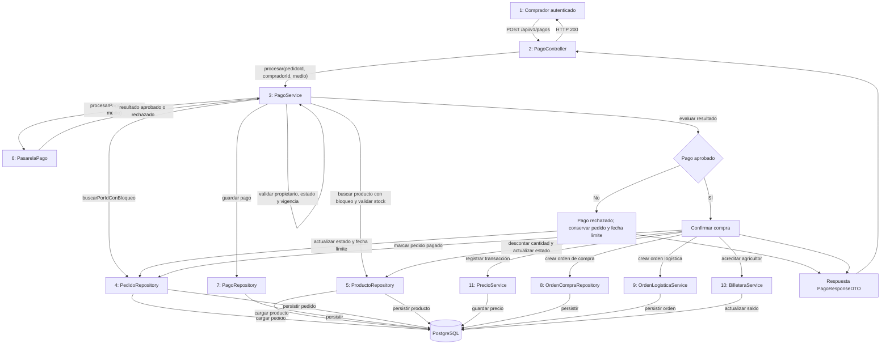
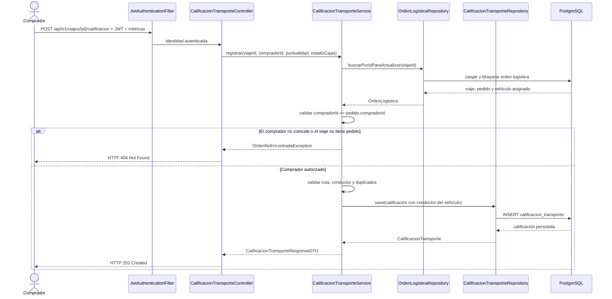
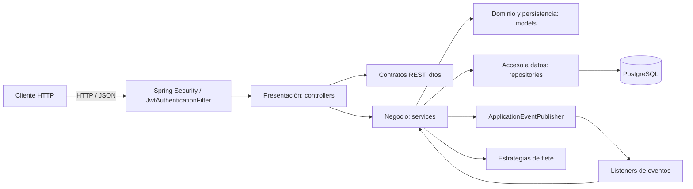
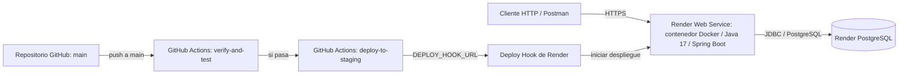

# Diagramas UML — AgroValle Connect

**Institución Universitaria Antonio José Camacho**

**Asignatura:** Ingeniería de Software II | **Período:** 2-2026

**Proyecto Integrador:** AgroValle Connect
**Ubicación:** `docs/diseno/architecture/diagramas-uml.md`

## Alcance y fuente de verdad

Estos diagramas describen el código y el despliegue vigentes. Cuando el escenario de la guía no
coincide con lo implementado, se muestra el flujo real y se deja explícita la brecha; no se presenta
un diseño futuro como si ya existiera. La guía indica `docs/architecture/`, pero este repositorio
conserva los artefactos de arquitectura en `docs/diseno/` por indicación de la docente.

## 1. Secuencia: autenticación e inicio de sesión JWT (HU-07)

`POST /api/v1/auth/login` normaliza el correo, verifica la contraseña con BCrypt y devuelve el JWT
en `AgricultorResponseDTO`.

## 2. Secuencia: publicación de cosecha/producto (HU-02)

El agricultor se obtiene del principal autenticado; no se consulta `FincaRepository` ni se crea una
entidad `Oferta`. La publicación crea un `Producto` asociado al agricultor.

## 3. Secuencia: consulta de precios promedio regionales (HU-03)

`GET /api/v1/precios/promedio` calcula el promedio de transacciones de las últimas 24 horas. Si no
hay datos para ese período, el servicio comunica que el precio no está disponible.

## 4. Colaboración: pago de pedido, inventario y rechazo (HU-09/HU-12)

El flujo de aprobación registra la compra y descuenta inventario (HU-09); la rama de rechazo conserva
el pedido durante 15 minutos para reintentar (HU-12 del Backlog). El PDF usa HU-12 para un escenario
distinto de confirmación de orden/carrito. El repositorio procesa un `Pedido` existente y no usa
carrito ni idempotencia.

## 5. Colaboración / Observer vigente: notificación de solicitud de contacto (HU-05)

El PDF asigna HU-13 al cambio de estado de despacho con notificación Observer, pero el Backlog
aprobado define HU-13 como calificación del producto y del agricultor. También define HU-08 como
actualización de estado de entrega. Ambas historias están previstas para una etapa posterior y no se
implementan aquí. Este diagrama muestra únicamente el Observer que sí existe: al registrar una
solicitud de contacto (HU-05), se persiste una notificación para el agricultor antes del commit.

```mermaid
flowchart TD
    Cliente["1: Comprador autenticado"]
    API["2: ContactoController"]
    Servicio["3: ContactoService"]
    ProductoRepo["4: ProductoRepository"]
    PedidoRepo["5: PedidoRepository"]
    MensajeRepo["6: ContactoMensajeRepository"]
    Publicador["7: ApplicationEventPublisher"]
    Evento["8: SolicitudContactoCreadaEvent"]
    Listener["9: SolicitudContactoCreadaListener"]
    Notificacion["10: NotificacionService"]
    NotificacionRepo["11: NotificacionRepository"]
    DB[("PostgreSQL")]

    Cliente -->|"POST /api/v1/contacto/mensaje"| API
    API -->|"enviarMensaje(...)"| Servicio
    Servicio -->|"validar producto y cantidad"| ProductoRepo
    ProductoRepo -->|"consultar"| DB
    Servicio -->|"crear pedido"| PedidoRepo
    PedidoRepo -->|"persistir"| DB
    Servicio -->|"guardar mensaje"| MensajeRepo
    MensajeRepo -->|"persistir"| DB
    Servicio -->|"publishEvent"| Publicador
    Publicador -->|"entregar evento antes del commit"| Evento
    Evento -->|"TransactionalEventListener"| Listener
    Listener -->|"registrar solicitud"| Notificacion
    Notificacion -->|"guardar"| NotificacionRepo
    NotificacionRepo -->|"persistir"| DB
    Servicio -->|"confirmación"| API
    API -->|"HTTP 200"| Cliente
```

## 6. Secuencia: calificación del servicio de transporte (HU-14)

El endpoint recibe la calificación de puntualidad y el estado de las cajas. El servicio carga el
viaje con bloqueo, comprueba que la identidad autenticada sea el comprador del pedido asociado y
deriva al conductor desde el vehículo asignado; el cliente no envía un identificador de conductor.
El modelo de estados vigente solo contempla `EN_RUTA` como estado de ruta activa, por lo que este es
el estado aceptado para registrar la calificación.

## 7. Componentes de la arquitectura en capas

## 8. Despliegue de staging

La aplicación y su base de datos de staging están desplegadas en Render. PostgreSQL también está
alojado en Render; no se usa Neon. El workflow ejecuta las verificaciones antes de invocar el Deploy
Hook.

## Brechas frente a la guía

- **Ubicación:** la guía especifica `docs/architecture/`; los artefactos se mantienen en
  `docs/diseno/` por indicación de la docente.
- **Identificadores HU-12/HU-13:** la guía y el Backlog aprobado asignan historias distintas a esos
  números. Se mantienen los flujos reales del Backlog: HU-12 es rechazo de pago y HU-13 es
  calificación; las historias de entrega y reputación se ejecutarán posteriormente.
- **Despliegue:** se refleja Render con PostgreSQL en Render, no Neon.tech.
