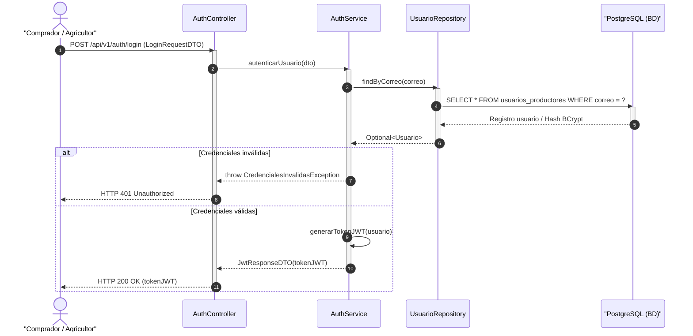
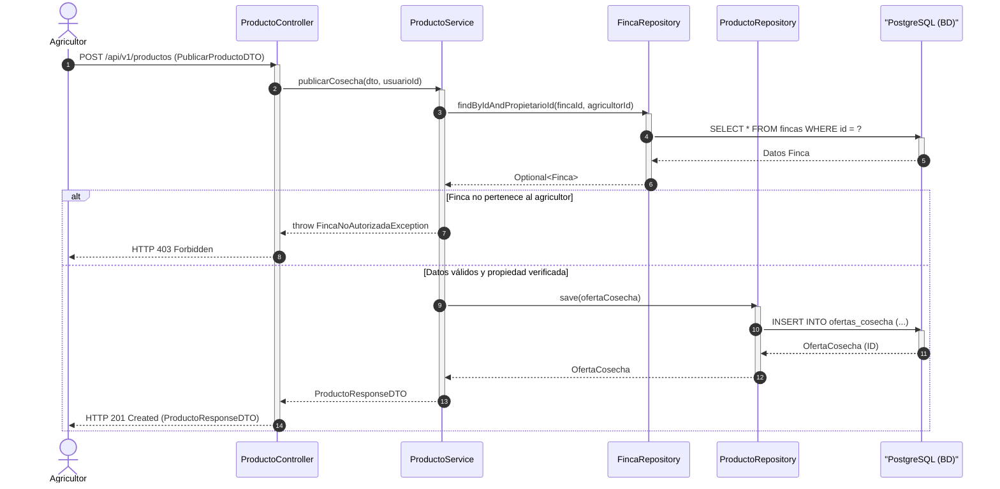
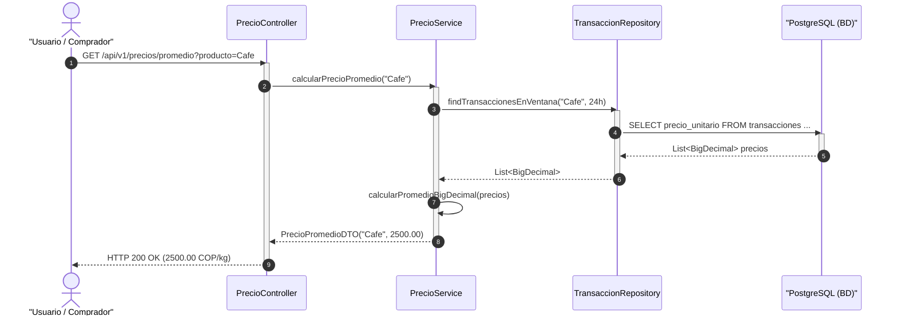
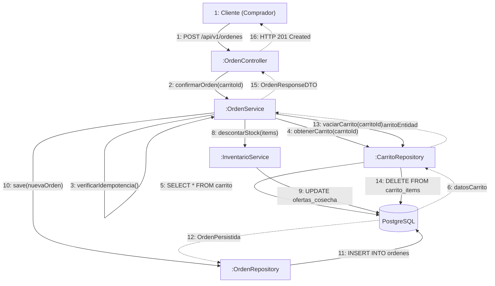
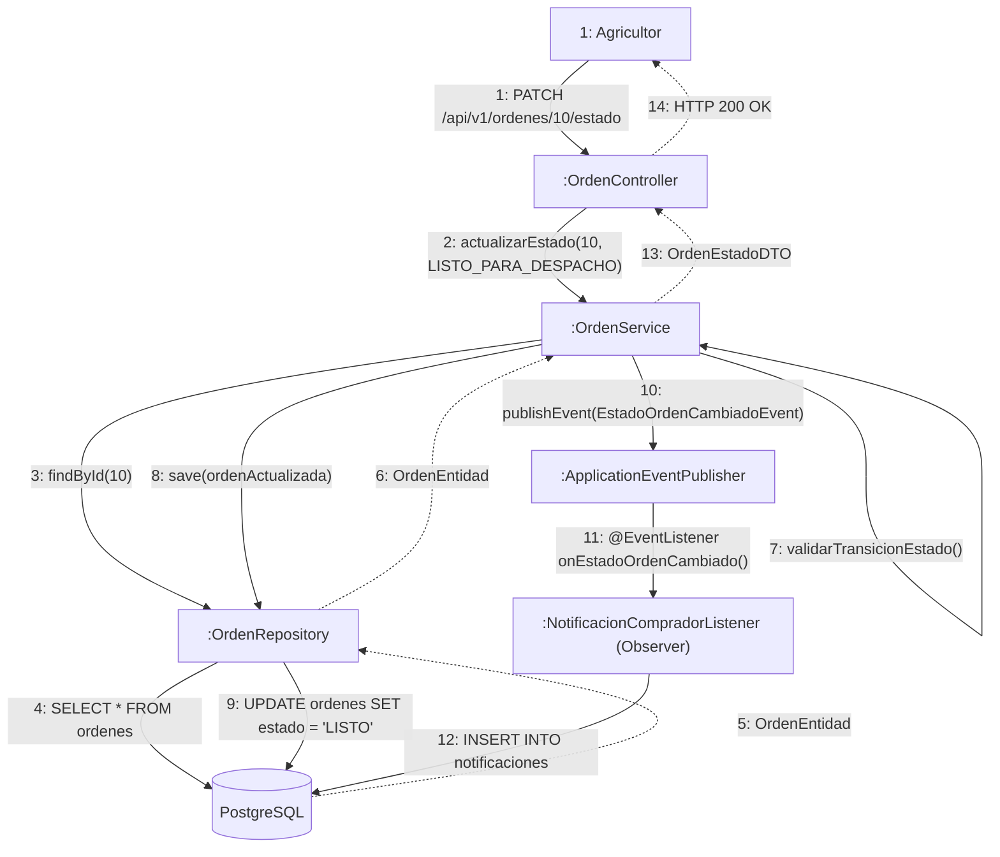

# Documento Consolidado de Diagramas UML — AgroValle Connect

**Institución Universitaria Antonio José Camacho**  
**Facultad de Ingeniería | Programa de Ingeniería de Sistemas**  
**Asignatura:** Ingeniería de Software II | **Período:** 2-2026  
**Docente:** Paola Andrea Bedoya Toro  
**Proyecto Integrador:** AgroValle Connect (Plataforma Agrícola del Valle del Cauca)  
**Estándar de Trazabilidad:** ISO/IEC/IEEE 29148:2018 & ISO/IEC 25010  

---

## 1. Justificación Técnica y Estándar de Representación

Para garantizar la mantenibilidad, auditabilidad y trazabilidad de los artefactos de software exigidos por el modelo de calidad **ISO/IEC 25010** y el estándar de especificación **ISO/IEC/IEEE 29148:2018**, este documento consolida la vista de diseño estructural e interaccional del sistema AgroValle Connect en sintaxis nativa **Mermaid.js**.

- **Renderizado Nativo en GitHub:** Permite visualizar los diagramas vectoriales sin depender de binarios pesados ni plugins de terceros.
- **Trazabilidad con el Código Fuente:** Al residir en texto plano dentro del repositorio, los diagramas evolucionan con cada Pull Request y commit del equipo.
- **Alineación con la Arquitectura en 4 Capas:** Especifica la separación estricta entre capa de presentación REST, seguridad, lógica de negocio y persistencia Spring Data JPA hacia PostgreSQL.

---

## 2. Diagramas de Secuencia UML (Interacción Cronológica en 4 Capas)

Los diagramas de secuencia especifican el flujo cronológico y los mensajes sincrónicos/asincrónicos intercambiados entre las capas de la arquitectura Spring Boot.

### Diagrama 1: Autenticación e Inicio de Sesión JWT (HU-07)

Especifica el flujo de autenticación, verificación de credenciales con hash BCrypt y generación del token JWT firmado.



---

### Diagrama 2: Publicación de Oferta de Cosecha (HU-02)

Valida la identidad del agricultor autenticado, verifica la pertenencia de la finca y persiste la oferta de cosecha con control de excepciones de autorización.



---

### Diagrama 3: Consulta de Precios Promedio Regionales (HU-03)

Ejecuta el cálculo estadístico de precios históricos de mercado en una ventana de 24 horas sobre transacciones reales consolidadas en el Valle del Cauca.



---

## 3. Diagramas de Colaboración / Comunicación

Enfatizan la estructura organizativa de los componentes y la numeración secuencial de mensajes entre objetos del dominio.

### Diagrama de Colaboración 1: Confirmación de Orden y Reserva de Inventario (HU-12)

Ilustra la verificación de idempotencia, obtención de ítems del carrito, descuento transaccional de inventario y creación atómica de la orden.



---

### Diagrama de Colaboración 2: Cambio de Estado de Despacho y Notificación (Patrón Observer — HU-13)

Modela la transición de estado de una orden logística y la notificación desacoplada al comprador mediante el patrón GoF **Observer** (`ApplicationEventPublisher` y `@EventListener`).



---

## 4. Diagrama de Componentes de la Arquitectura MVC en 4 Capas

Representa la estructura física y lógica de los módulos de software, sus interfaces y dependencias cruzadas entre presentación, seguridad/middleware, dominio y persistencia.

```mermaid
componentDiagram
 package "Capa de Presentacion (REST API)" {
 [AuthController]
 [ProductoController]
 [OrdenController]
 }
 package "Capa de Seguridad & Middleware" {
 [Spring Security Filter]
 [JwtAuthenticationFilter]
 }
 package "Capa de Logica de Negocio (Domain Services)" {
 [AuthService]
 [ProductoService]
 [OrdenService]
 [FleteStrategyContext]
 }
 package "Capa de Acceso a Datos (Spring Data JPA)" {
 [UsuarioRepository]
 [ProductoRepository]
 [OrdenRepository]
 }
 database "PostgreSQL Cloud" {
 [Base de Datos Staging]
 }
 [AuthController] ..> [AuthService]
 [ProductoController] ..> [ProductoService]
 [OrdenController] ..> [OrdenService]
 
 [Spring Security Filter] --> [JwtAuthenticationFilter]
 [JwtAuthenticationFilter] ..> [AuthController]
 [AuthService] ..> [UsuarioRepository]
 [ProductoService] ..> [ProductoRepository]
 [OrdenService] ..> [OrdenRepository]
 [OrdenService] ..> [FleteStrategyContext]
 [UsuarioRepository] --> [Base de Datos Staging]
 [ProductoRepository] --> [Base de Datos Staging]
 [OrdenRepository] --> [Base de Datos Staging]
```

---

## 5. Diagrama de Despliegue Físico de Infraestructura

Mapea la distribución física en la nube, los nodos de cómputo y el flujo automatizado de Entrega y Despliegue Continuo (CD).

```mermaid
deploymentDiagram
 node "Cliente Web / Mobile" as client {
 [Navegador Web / Postman]
 }
 node "GitHub Platform" as github {
 [GitHub Repository (main branch)]
 [GitHub Actions Runner (CD Pipeline)]
 }
 node "PaaS Cloud Infrastructure (Render / Railway)" as paas {
 node "Docker Container (Spring Boot App)" {
 [Java 17 Runtime Environment]
 [AgroValle Backend (.jar)]
 }
 }
 node "PostgreSQL Cloud DB (Neon.tech)" as dbnode {
 database "agrovalle_staging" as db
 }
 client -- "HTTP REST (Port 8080 / SSL)" --> paas
 github -- "Webhook Event (DEPLOY_HOOK_URL)" --> paas
 paas -- "JDBC Connection (Port 5432)" --> dbnode
```
